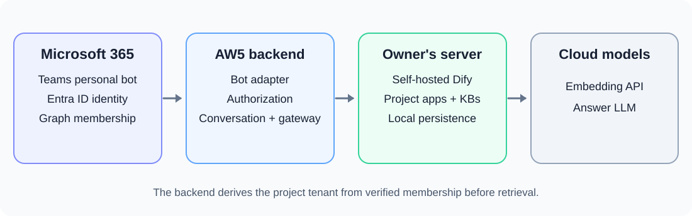
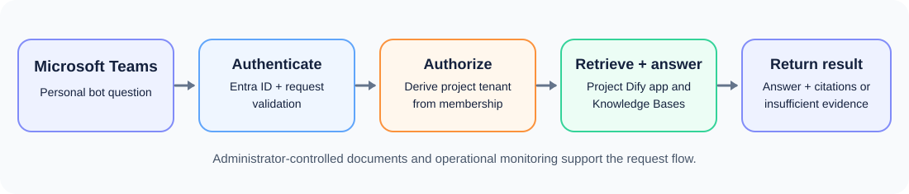

# 2. Requirements Specification

**Project:** Multi-Tenant RAG-based Conversational AI for Software Development Lifecycle (AW5)

**Status:** Proposed MVP requirements for DS2. The Teams integration, trusted authorization backend, Project B onboarding, and cross-tenant isolation have not yet been verified.

**Detailed working notes:** [Earlier requirements draft](aw5-ds2-requirements-specification-draft-2026-09-19.md).

## 2.1 System Description

AW5 is a proposed conversational assistant for members of software projects within an organization. A member asks a question through a personal Microsoft Teams bot conversation. The system identifies the member, determines which project the member may access, retrieves relevant evidence from that project's selected Software Development Life Cycle (SDLC) documents, and returns an answer with source citations. When the documents do not support an answer, the assistant states that the evidence is insufficient.

One AW5 tenant represents one software project. Nature Footprint is the first project tenant and currently has three Knowledge Bases for its TOR, System Design Specification, and ER/dbdiagram artifacts. Project B is another real organizational software project planned for separate onboarding. These are examples of the project tenants that the architecture can support; the system is not limited to two projects.

The MVP covers project-specific questions, access control, administrator-controlled document onboarding, and operational monitoring. It does not automate the full SDLC, edit production artifacts, support anonymous access, or allow every member to upload arbitrary files. Dify and persistent project knowledge run on the owner's computer; cloud services provide embedding and answer models.

### 2.1.1 Perspective

AW5 sits between the organization's Microsoft 365 environment, a trusted AW5 backend, a self-hosted Dify installation, and external model APIs. Figure 2.1 shows the proposed relationship. The Microsoft Teams bot and trusted backend are planned MVP components; the recorded self-hosted Dify workflow is current evidence, but the figure as a whole is a design proposal.

*Figure 2.1: Proposed AW5 system perspective. The [detailed editable architecture diagram](../../../architecture/diagrams/aw5-mvp-system-architecture-overview.drawio) is available separately.*

The main functions are summarized as follows:

- **Authentication:** Microsoft Entra ID identifies the organization user; the Teams Bot Adapter validates the incoming bot activity and identity information.
- **Project authorization:** The AW5 backend determines the user's current project membership and derives the authorized AW5 `tenant_id` before any retrieval. Microsoft Graph provides membership and role changes to the backend.
- **Conversation management:** A personal Teams conversation is mapped to the authenticated user and active project tenant so conversation history does not cross projects.
- **Knowledge management:** Authorized administrators onboard project files. Each project's Knowledge Bases remain associated with that project's tenant.
- **Evidence retrieval and answering:** The backend routes an authorized request to the corresponding Dify app. Dify searches that project's Knowledge Bases and generates an evidence-grounded answer with citations or an insufficient-evidence response.
- **Operations:** The system records authorization outcomes, latency, provider errors, available token counts, retries, and estimated API cost without imposing an AW5 per-user usage quota.

## 2.2 Requirements

The proposed MVP requirements are grouped by system function in the following subsections. **Must** indicates an essential MVP requirement; **should** indicates a preferred behavior that can be refined during implementation; **may** indicates an optional extension. Requirement IDs support review and later testing. They do not imply that a function has already been implemented.

### 2.2.1 General

**G1** AW5 must allow an authenticated member to ask questions about selected SDLC artifacts belonging to an authorized software project.

**G2** AW5 must treat one software project as one AW5 tenant and use AW5 `tenant_id` as the project-scope identifier. Dify's internal Workspace `tenant_id` must not be treated as the AW5 tenant identifier.

**G3** The MVP must support Nature Footprint and the separate onboarding of Project B as real organizational project tenants. The architecture should permit additional project tenants without changing the authorization rule.

**G4** The MVP must use a Microsoft Teams personal bot as its user-facing conversation channel and self-hosted Dify as its RAG runtime.

**G5** AW5 must not impose a per-user question, daily, monthly, or token usage quota. External provider limits and outages should be reported as operational conditions.

*Figure 2.2: Main functions of the proposed AW5 MVP.*

### 2.2.2 Authentication

**A1** The Authentication function must identify organization users through Microsoft Entra ID before processing a project question.

**A2** The Teams Bot Adapter must validate incoming Teams activities and the associated identity information before passing a request to the trusted backend.

**A3** AW5 must not expose Dify app keys, model-provider credentials, database credentials, or project files to the Teams client.

### 2.2.3 Project Authorization

**T1** The Authorization function must derive the effective AW5 `tenant_id` from the authenticated user's current project membership before invoking Dify or retrieval. User text, model output, and caller-supplied project identifiers must not grant access.

**T2** The Authorization function must deny a request before retrieval when identity, membership, tenant mapping, or role information is missing, invalid, revoked, or inconsistent.

**T3** The MVP must map one Microsoft Team to one AW5 project tenant. A Teams Owner must map to `project_admin`, a Teams Member to `project_member`, and a Teams Guest must be denied by default.

**T4** AW5 must keep the `system_operator` role separate from project roles; Teams ownership must not grant system-operator privileges.

**T5** AW5 must synchronize or revalidate membership and role changes from a trusted Microsoft Graph source. Once the backend observes a revocation, it must deny subsequent retrieval for that membership; the membership freshness policy remains to be specified.

**T6** If a user belongs to multiple project tenants, AW5 must allow selection only among verified memberships and clearly identify the active project.

### 2.2.4 Conversation

**C1** AW5 must accept natural-language questions in each user's personal Teams bot conversation and return the response to that conversation.

**C2** AW5 must scope conversation state by at least the authenticated platform user and AW5 `tenant_id`. Switching projects must not reuse another project's conversation history.

**C3** Ordinary project users must not be able to view another user's bot conversation through the normal chat interface.

**C4** The response should clearly distinguish an evidence-grounded answer, source citations, insufficient evidence, access denial, and an operational error.

### 2.2.5 Knowledge Management

**K1** Authorized administrators must control project-document onboarding. Ordinary project members must not upload or immediately ingest arbitrary files in the initial MVP.

**K2** Every onboarded primary file and its derived knowledge must be attributed to exactly one AW5 project tenant and retain source provenance.

**K3** Nature Footprint must use separate Knowledge Bases for its TOR, System Design Specification, and ER/dbdiagram primary artifacts, connected to one Knowledge Retrieval node.

**K4** Each Project B Knowledge Base must remain separate from Nature Footprint knowledge and be accessible only through Project B's authorized Dify app mapping.

**K5** The onboarding function should provide an administrator-visible status showing whether a document is ready for retrieval. Original source files must be preserved when cleaned or derived material is created.

### 2.2.6 Retrieval and Answering

**R1** The Dify Gateway must select the Dify app from a trusted server-side mapping of the authorized AW5 `tenant_id`. The Teams client must not choose an arbitrary app or Knowledge Base.

**R2** Retrieval must search only Knowledge Bases assigned to the authorized project tenant. An unauthorized or manipulated project selection must fail before retrieval.

**R3** The workflow must use one Knowledge Retrieval node over the authorized project corpus; it must not require separate TOR, SDS, and ER routing branches.

**R4** The answer must cite the actual source documents that support its claims and must not attribute evidence to a document from which it was not retrieved.

**R5** When available evidence is insufficient, the answer must state that limitation instead of inventing an unsupported answer.

**R6** Production prompts and workflow logic must remain generic; they must not encode known test questions, expected answers, corpus-specific source mappings, or case-specific exceptions.

### 2.2.7 Administration and Operations

**O1** AW5 must record authorization outcomes, end-to-end latency, material provider failures, retry outcomes, available token counts, and estimated API cost without storing private document content in routine logs.

**O2** AW5 must use a per-request timeout and bounded retry policy for stalled requests. It should avoid duplicate downstream processing when Teams delivers the same activity more than once.

**O3** System operators must be able to manage trusted tenant-to-Dify-app mappings and operational credentials separately from project-admin permissions.

**O4** AW5 should expose a clear operational response when a model provider or retrieval service is unavailable.

### 2.2.8 Quality, Security, and Privacy

**Q1** The trusted backend must enforce project authorization before retrieval and prevent evidence from one project tenant appearing in another tenant's retrieval results.

**Q2** The MVP must validate isolation in both directions using at least two real onboarded project tenants and owner-approved controlled evidence before claiming that multi-tenant isolation is verified.

**Q3** External bot callbacks and backend API traffic must use authenticated HTTPS transport, and operational credentials must remain server-side.

**Q4** Persistent source files, derived knowledge, and vector/index storage must remain on the owner's computer for the MVP. The design must disclose that cloud embedding receives document chunks and query text and that the answer model receives the question and selected evidence/history.

**Q5** AW5 should measure end-to-end p50 and p95 latency, provider failures, and answer/citation correctness over a representative evaluation. Numeric acceptance thresholds remain to be agreed before formal evaluation.

**Q6** The response format should remain readable within Microsoft Teams. Access-denied messages must not disclose whether an unauthorized project or document exists.

The requirements above describe the intended MVP. The currently recorded five-node Nature Footprint Dify workflow and its targeted diagnostic provide limited RAG evidence; they do not verify the proposed Teams integration, authorization backend, Project B onboarding, or tenant isolation.
